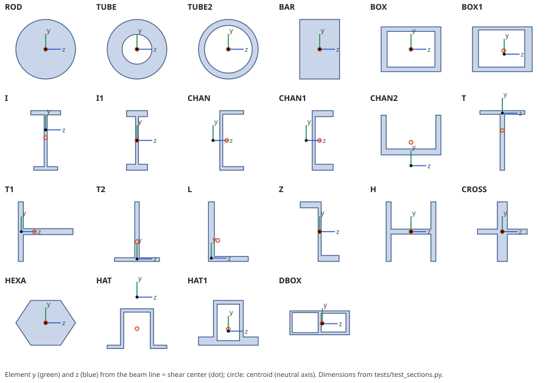

# Beam sections

nastran-pv draws every CBAR and CBEAM as its cross section swept along the element, so you can
check orientation vectors, OFFT, offsets, tapers and the shear-center/neutral-axis offset by eye.
It also tabulates the section properties it computes from the geometry next to the card values.

* ParaView: the **Nastran Beam Sections** filter and the `beams` view (toolbar macro *NPV Beams*), see
  [ParaView](paraview.md#glyph-filters).
* CLI: `nastran-pv convert DECK --beam-sections` adds a `BeamSections` block, and
  `nastran-pv sections DECK [--pid ...] [--csv FILE]` prints the table (see [CLI](cli.md#beam-sections)).

The sweep needs only the `Lines` block and three root tables, not the deck. A `.vtm` or VTKHDF
file written without `--beam-sections` can be swept later (`nastran-pv convert model.vtm
--beam-sections`), and the ParaView filter works on any reader output.

## What is drawn

| Property | Section |
|---|---|
| PBARL, PBEAML (group MSCBML0) | the exact outline of the library shape; PBEAML gets one ring per X/XB station, lofted linearly |
| PBAR, PBEAM | an *equivalent rectangle*: `h = sqrt(12 I1/A)` along y and `b = sqrt(12 I2/A)` along z; when the C/D/E/F stress points span a box in y and z, that box instead; a square of area A when I1 or I2 is zero (an axial-only bar). PBEAM: per station, centred on the neutral axis (N1A/N2A to N1B/N2B) |
| others with A, I1, I2 (PBCOMP, PBEAM3, ...) | the equivalent rectangle |

PBARL/PBEAML with a user-defined group, dimensions that leave no material (walls thicker than the
section, a TUBE whose inner radius exceeds the outer one), a PBAR/PBEAM without a positive area,
and a missing property are skipped with one warning per PID ("beam section of PID n not drawn").

## Element frame and offsets

The frame follows the CBAR/CBEAM definition and is stored on `Lines` (`Axis1`-`Axis3`, unit x/y/z in
basic; `OffsetA`/`OffsetB` in basic):

* **Orientation vector v**: GA→G0, or X. With OFFT position 1 `G` (the default) X is given in the
  displacement system (CD) of GA; with `B` it is basic.
* **Offsets WA/WB**: OFFT positions 2 and 3. `G` is the displacement system of that end's grid, `B`
  is basic, and `O` (or `E`) is the element system, taken from the un-offset GA–GB line.
* **Axes**: x runs from offset end A to offset end B, `z = x × v` and `y = z × x`.

A one-letter OFFT `B` is read as `BGG`. NX numeric OFFT codes and CBEAM BIT are not supported: they
warn and use `GGG`. A missing or parallel orientation vector warns and uses an arbitrary y axis.

pyNastran's own `rotate_v_wa_wb` is not used, because it rotates X twice when GA has a displacement
system.

## Section placement and axes

The MSC/NX library figures have their origin at the shear center ("The origin of element coordinate
system is centered at the shear center of the cross-section oriented as shown", PBARL remark). So
each PBARL/PBEAML outline is placed with its **computed shear center on the element line**. The
neutral axis (centroid) is offset from it for shapes that are not symmetric.

In the section, element **y is the figures' vertical axis and z the horizontal one** (BAR: DIM1 along
z, DIM2 along y, so `I1 = DIM1·DIM2³/12`). Shapes that are not symmetric about y open toward +z as in
the NX figures that pyNastran reproduces:

| Shape | DIM order | Opening / layout |
|---|---|---|
| CHAN, CHAN1 | width (with web) or flange beyond web, depth, web, flange (CHAN) | web on the -z side, flanges toward +z |
| L | width, height, horizontal leg t, vertical leg t | vertical leg at -z, horizontal leg at -y |
| T1 | flange height, web length, flange t, web t | vertical flange at -z, web toward +z |
| Z | flange beyond web, web t, web clear height, depth | top flange toward -z, bottom flange toward +z |
| T / T2 | flange width, depth, flange t, web t | flange on top (T) or at the bottom (T2) |
| HAT / HAT1 | depth, t, top width, lip (HAT); see the NX figure for HAT1 | HAT open toward -y (lips at the bottom); HAT1 base plate at -y |
| BOX1, DBOX | walls top/bottom/left/right as numbered | left = -z |

A solver that mirrors one of these figures would show that section flipped about y.

The figure is generated from the code (`PYTHONPATH=src python docs/build_section_figure.py`).

## Section properties

Computed once per unique shape and dimension set:

* **A, I1, I2, I12 and the centroid**: exact for the polygon (`I1 = ∫y² dA`, bending in plane 1).
  Circles are drawn as 48-gons but use the closed-form values.
* **J, shear center and warping constant Cw**: a Saint-Venant warping finite-element solve on the
  section. It uses bilinear quads on an exact tensor-grid mesh of the outline, with at least four
  elements through every wall. ROD/TUBE/TUBE2 use the closed form (J = π(Ro⁴ - Ri⁴)/2). Tested
  against: unit square J = 0.1406 (within 0.05%), the thin-walled channel shear center
  `3b²t/(6bt + ht)` (within 0.3%) and Bredt's J for a thin box (within 1.5%; the FE is the thick-wall
  value).
* Mirror symmetry snaps the shear center onto the symmetry axis and I12 to 0; the point-symmetric Z
  has its shear center at the centroid and keeps its I12.

The equivalent rectangle of a PBAR/PBEAM has no computed J or Cw. The card values are the reference.

## The section table

Root field data `SECTION_*`, one row per PID and station. It is written for every deck with
CBAR/CBEAM (not only with `--beam-sections`), so the ParaView filter and later sweeps need no
deck; `nastran-pv sections` prints the main columns:

| Column | Meaning |
|---|---|
| `PID Station Property Shape Equivalent` | X/XB of the station (0 and 1 for PBAR/PBARL), card type, library shape or `EQUIV` |
| `A I1 I2 I12 J Cw` | computed (above) |
| `CentroidY CentroidZ` | neutral axis (centroid) relative to the beam line, element y/z; the beam line is the shear center of library shapes |
| `RefA RefI1 RefI2 RefI12 RefJ RefSource` | card values (PBAR/PBEAM) or pyNastran's PBARL area (`pyNastran`); NaN when unknown |
| `MaxRelDiff` | the largest relative difference to the reference; `sections` flags more than 2% as MISMATCH |
| `Ring0 NRing` | rows of `SECRING_Start/Count/Hole`, which index the ring vertices `SECPT_Y/SECPT_Z` |

pyNastran's PBARL inertia formulas are wrong for several shapes (T, L, DBOX among them, checked by
hand), so only its areas serve as references for library shapes. A MISMATCH on a PBAR/PBEAM means the
C/D/E/F box does not match A, I1 and I2, which usually points to a typo in the card.

## The swept block

`BeamSections` (CLI) and the filter output are polydata with cell arrays `EID PID MID ElementType`,
`BeamPart` (0 section, 1 shear-center axis, 2 neutral axis, 3-5 x/y/z triad) and `Face` (0 wall,
1 end A, 2 end B), and point arrays `GA GB StationT`. Walls and caps form closed surfaces with
outward normals. The cells carry `PID` and `EID`, so the reader's visibility checklists and Show
Only/Hide also apply to the filter. The block is not part of the mesh: it never adds mass or
derived fields, and the topology tools ignore it.

**Deformed shape.** Each point moves with its two end grids as a rigid section:
`u = (1 - t)(dA + θA × (p - GA)) + t(dB + θB × (p - GB))`, with small rotations and rigid offsets.
With results attached, `BeamSections` carries this as `Displacement` (Warp By Vector shows twist and
bending). The filter's *DeformationScale* applies it directly (the `beams` view stays undeformed, like its
ghost mesh, unless called with `scale=`). Bending between the ends is linear, not the cubic
deflected shape.
