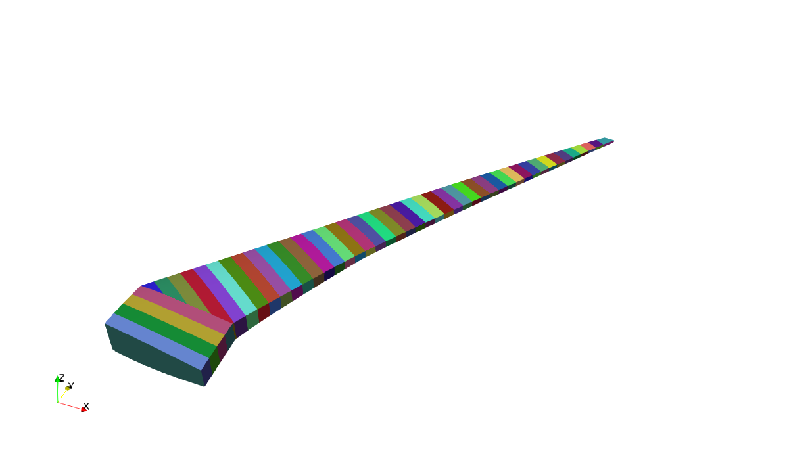
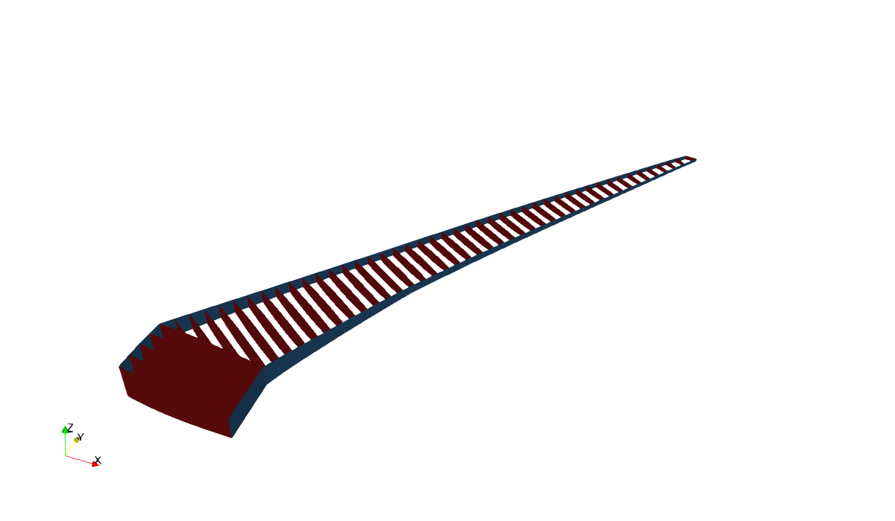
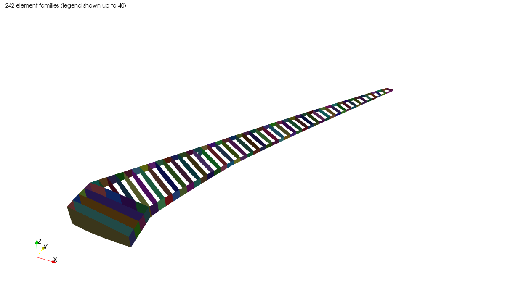
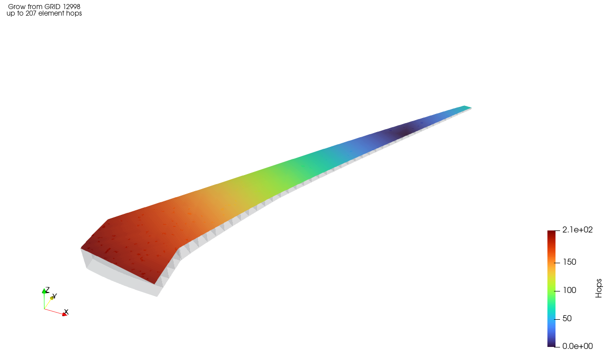
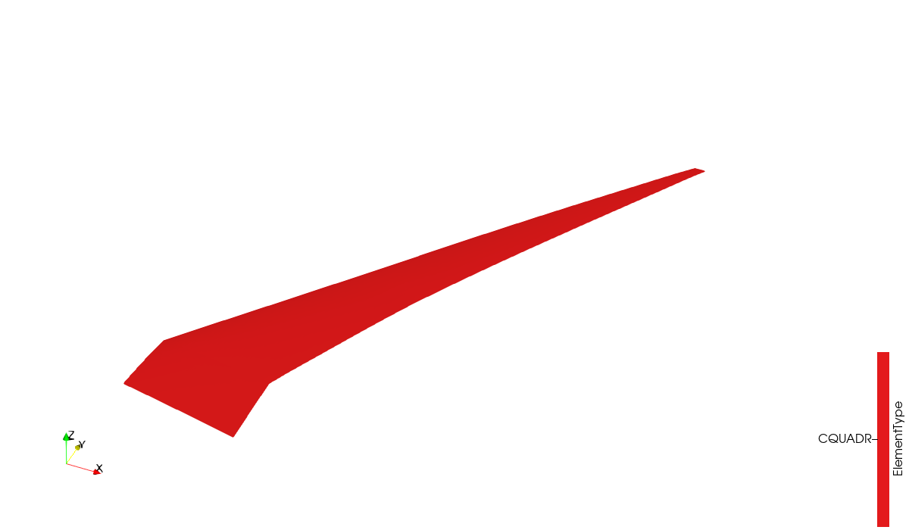
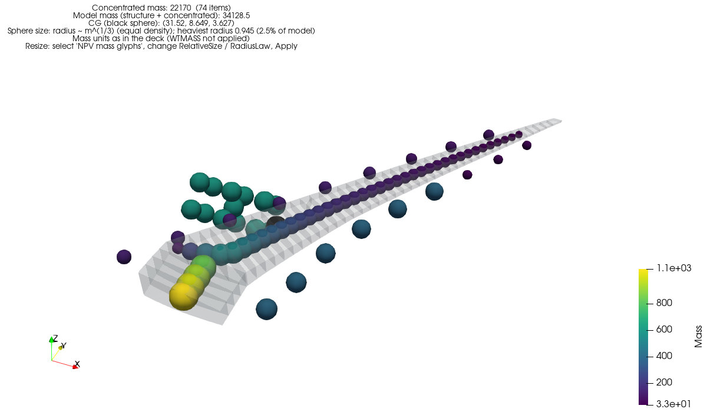
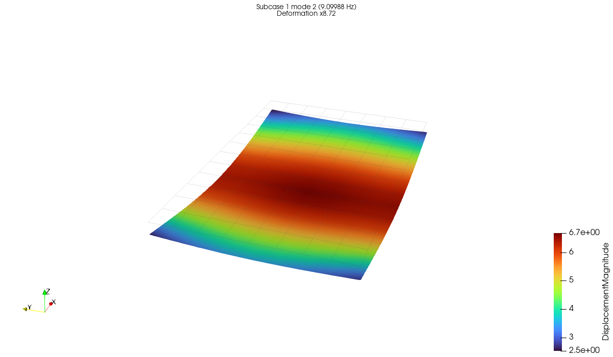
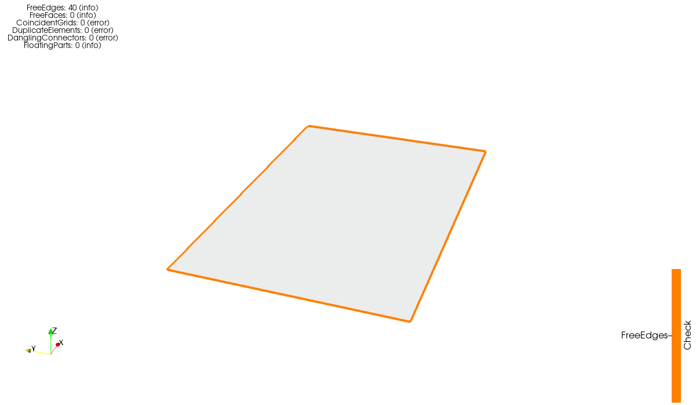
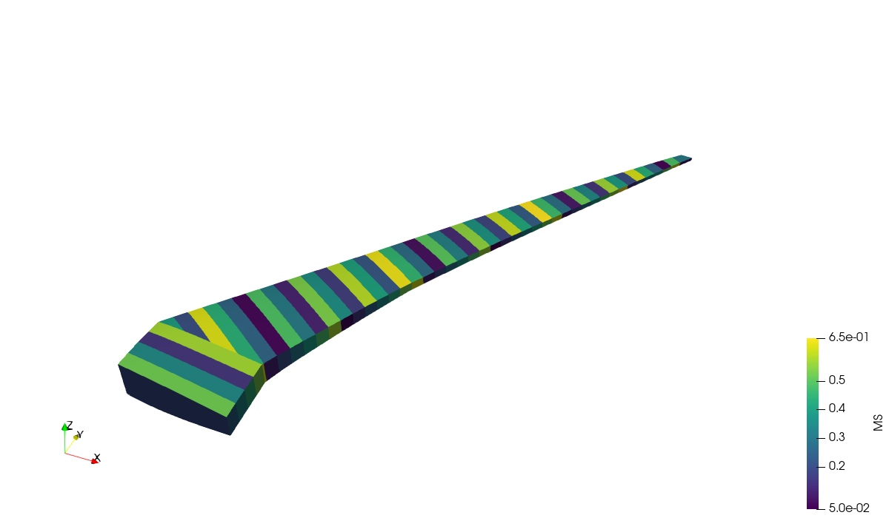

# ParaView tutorials

Step-by-step walkthroughs in the ParaView GUI: open a deck, browse and isolate parts of it the way
you would in Femap, check mass and loads, look at mode shapes, find mesh problems and color the
model by your own data. Every step uses ParaView's own menus and panels, the *Filters > Nastran*
filters, or the *NPV* toolbar buttons. [ParaView](paraview.md) is the reference for all of them.

## Before you start

* Load the plugin once: *Tools > Manage Plugins > Load New...*, pick
  `paraview/nastran_bdf_reader.py`, and tick *Auto Load*.
* Install the toolbar buttons with `python paraview/install_macros.py`, then restart ParaView.
  They appear on the *Macros* toolbar as *NPV Masses*, *NPV Show Only* and so on.
* Most tutorials use the uCRM-9 wingbox
  ([Install](install.md#example-datasets)), coarse mesh:
  `gpk4zn73xn-1/uCRM9/uCRM9/Mesh/Coarse/FEM/run_uCRM-9_static_cruise_coarse.bdf`. The mode-shape
  tutorial uses the demo deck `docs/models/demo.bdf` from the repository and its solved `.op2`.
* Turn on *Auto Apply* (the button with the green check mark on the Properties panel toolbar) so
  changes take effect without clicking *Apply*. The steps below still say *Apply* where it matters.

## 1. Open a deck and color it by property

1. *File > Open*, choose the run deck, and pick **Nastran Bulk Data (nastran-pv)** in the reader
   list (*Set reader as default* saves the question next time).
2. In the Properties panel, leave all blocks on and click **Apply**.
3. Click **NPV PID**. The mesh gets one color per property, with the property IDs in the legend.

   By hand: select the reader in the Pipeline Browser, pick `PID` in the *Coloring* list, then
   click **NPV Index Colors** to turn the color bar into one color per ID.



*View > Information* lists the blocks, cell counts and the model summary (`ModelMass`, `ModelCG`,
`ActiveLoadSets`) under *Field Data*.

## 2. Browse the model tree

The reader output is a tree like Femap's Model Info pane.

1. With the reader selected, open *View > MultiBlock Inspector*. Its top level is `Model`
   (the blocks: Shells, Masses, Rigid, Loads, ...) followed by `Properties`, `Materials`,
   `ElementTypes`, `Families` and `Groups`.
2. Untick `Root` and tick `Groups > WING_RIBS`: only the ribs are drawn. Tick nodes under
   `Properties` to add single properties. A part is drawn when *any* ticked node contains it.
3. Right-click a node to give it its own color or opacity.
4. To keep a selection as its own object, use *Filters > Alphabetical > Extract Block*. In
   its Properties panel, set *Assembly* to `Assembly` and tick the nodes, for example
   `Groups/WING_SPARS`. Extract the ribs the same way and color each extract.



In the render view you can also right-click a part and choose *Hide Block* or *Show Only Block*.

## 3. Hide and isolate parts like Femap

The MultiBlock Inspector shows a part when *any* ticked node contains it. Femap's *Show/Hide* works
the other way: an element shows only if its group, property, material and type are all on. That
logic lives in the reader's Properties panel.

1. Select the reader. Under **Visible Groups**, untick `WING_U_SKIN` and `WING_L_SKIN`, then
   **Apply**. The skins are gone and the spars and ribs show through.

   

2. Untick a few entries under **Visible Properties** as well. Elements now need both their group
   and their property ticked. Elements without a category pass that list: CBUSHes have no
   material, so *Visible Materials* never hides them.
3. Select some elements: press `S` (*Select Cells On*) and drag a box, or use *Edit > Find Data*
   with a query such as `EID >= 1000`. Then:
   * **NPV Hide** adds them to the reader's *Hidden Elements*.
   * **NPV Show Only** shows only them (loads and SPCs stay).
   * **NPV Only Property** / **NPV Only Material** untick every property (or material) except
     the selected elements' ones.
4. **NPV Show All** ticks everything again and clears both ID lists.

*Show Only Elements* and *Hidden Elements* are plain text, such as `1001 1002 2000-2010`, so you
can also type or paste ID lists into them. Model mass and CG keep describing the whole deck.

## 4. Select everything connected inside a group

Femap's "select connected" from a point, without crossing into the next group:

1. Press `D` (*Select Points On*) and click a grid on the upper skin.
2. Click **NPV Grow from Selection**. *NPV grow* colors every element by its distance from the grid
   in element hops.
3. Select *NPV grow* in the Pipeline Browser and set **Stay Within** to *seed groups*. The growth
   now stops at the spars and ribs. *Seed families*, *seed properties* and *seed materials* stop at
   those boundaries instead. Uncheck card types such as `RBE3` under *Card Types* to stop at them
   too.

   

4. Click **NPV Show Only Reached** to isolate what was reached, or **NPV Hide Reached** to hide it.
   Masses and bushes on reached grids count as reached.

   

5. **NPV Show All** brings the rest back. *Limit Hops* / *Max Hops* on *NPV grow* limit the
   growth to N elements from the seed. The rules are explained in [Model tools](tools.md).

## 5. Check mass, CG and loads

1. Click **NPV Masses**. Each concentrated mass becomes a sphere (or an inertia ellipsoid) colored
   by mass, the model CG is a black sphere, and the overlay text gives the totals.

   

2. To read the numbers, split the view (the split button at the top right of the render view),
   choose *SpreadSheet View*, show the reader, and set *Attribute* to `Field Data`.
   `StructuralMass`, `ConcentratedMass`, `ModelMass` and `ModelCG` are in the first row.
3. To size the spheres, select *NPV mass glyphs* and change *RelativeSize* or *RadiusLaw*
   ([Glyph filters](paraview.md#glyph-filters)).
4. **NPV Loads** draws the case control's `LOAD` set as arrows, with its resultant in the overlay.
   **NPV SPC** colors the constrained grids by DOF. Every load set is also in the tree under
   `Model > Loads`, for example `LOAD_1001`.

## 6. Look at mode shapes

1. Open `docs/models/demo.bdf`. In the reader's Properties panel, set **OP2 File Name** to the
   solved `.op2` (or MSC/NX `.h5`) and click **Apply**. Every mode (or subcase, or load step)
   becomes a time step.
2. Click **NPV Results**: the deformed shape colored by displacement over a gray outline of the
   undeformed mesh. The overlay names the mode and its frequency.
3. Step through the modes with the *VCR* toolbar (or the time field next to it). To change the
   amplification, select *NPV warp* and change *Scale Factor*.



`Displacement` (points) and, when the results have stress, `VonMisesMax` (cells) are on the mesh
blocks for coloring by hand.

## 7. Find mesh problems

1. Click **NPV Model Check**. Free edges, free faces, coincident grids, duplicate elements,
   dangling connectors and floating parts are drawn on a translucent mesh, and the overlay counts
   each check.

   

2. Select *NPV check* to turn single checks off or change *Tolerance*. Its second output (open it
   in a SpreadSheet View) lists the counts.
3. **NPV Parts** colors each connected part. Select *NPV parts* and untick `RBE2`/`RBE3` under
   *Card Types* to see what the rigid elements hold together.

## 8. Color the model by your own table

1. Save your values as a CSV file keyed by element, property, material, grid, family or group,
   for example margins of safety per property:

   ```
   PID,MS
   101,0.42
   102,0.08
   ```

2. Select the reader and add *Filters > Nastran > Nastran Map Table*. Set *Table File Name*
   to the CSV and *Key* to `PID`, then click **Apply**.
3. Color by `MS`. Excel sheets, JSON and SQLite queries work the same way
   ([Fields](fields.md#paraview-filters)).



The filters keep the model tree, so the MultiBlock Inspector and the visibility lists still work
on *Nastran Map Table*'s output.
